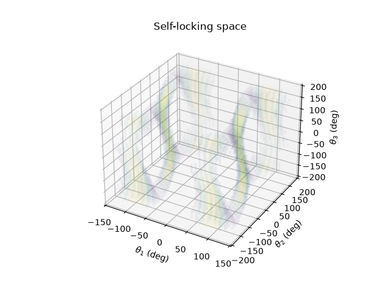

# 这是理论力学荣誉课作业 解决关于机械臂动力学问题

目录结构:
```
.
├── README.md
├── assets              存放实验照片等
├── model               机械臂建模相关
├── task1.py            第一次作业脚本
└── visualizatio        可视化
```

## task1
目前实现:
1. 输入三个关节角度输出关节力矩
2. 画出固定某两个电机旋转另一个电机时三个关节力矩的图像, 分别画出考虑摩擦力和不考虑摩擦力的情况
3. 输入最大静摩擦力, 画出自锁的三维图, 图中颜色表示摩擦力的冗余程度(我想表达的意思是目前的摩擦力距离最大静摩擦力还剩多少)

结果复现:

``` bash
python -m venv .venv
. .venv/bin/activate
pip install -r requirements.txt
python task1.py
```

### 模型选择与方法说明
模型是三自由度机械臂, 末段负载, 考虑关节重力和关节摩擦
方法: 
使用虚功原理, 把笛卡尔坐标系下的力转换到关节"坐标系"下的力矩
三个关节重力, 一个末端负载, 构造四个Jacobian矩阵实现变换

### 结果与分析
固定12电机角度, 三个关节力矩


固定13电机角度, 三个关节力矩


固定23电机角度, 三个关节力矩


以上说明转动任一关节, 都会对三个电机同时产生影响

能发生自锁情况时三个关节角度的空间图
黄色处摩擦力冗余较大, 紫色处摩擦力冗余小. 无颜色处无法实现自锁

