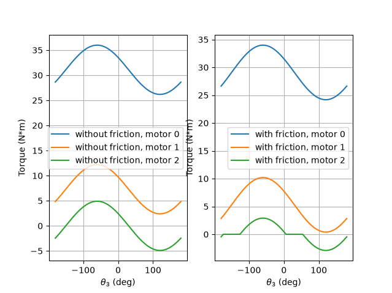
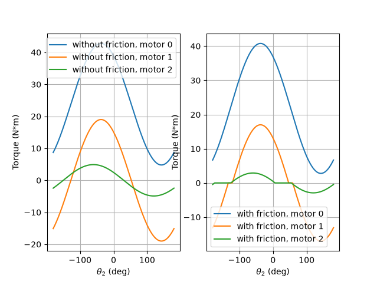
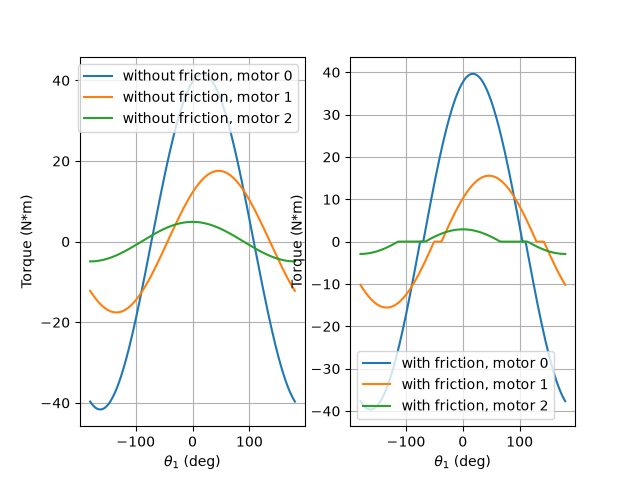
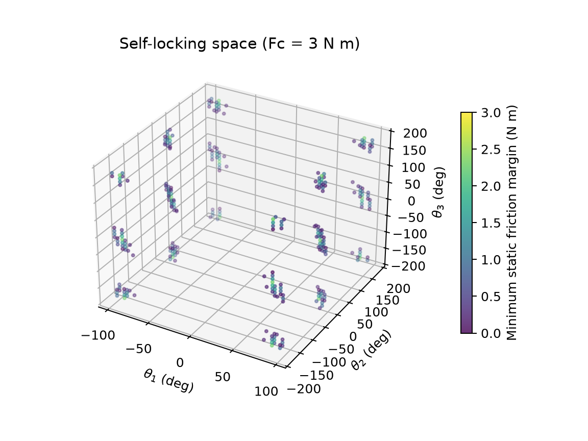
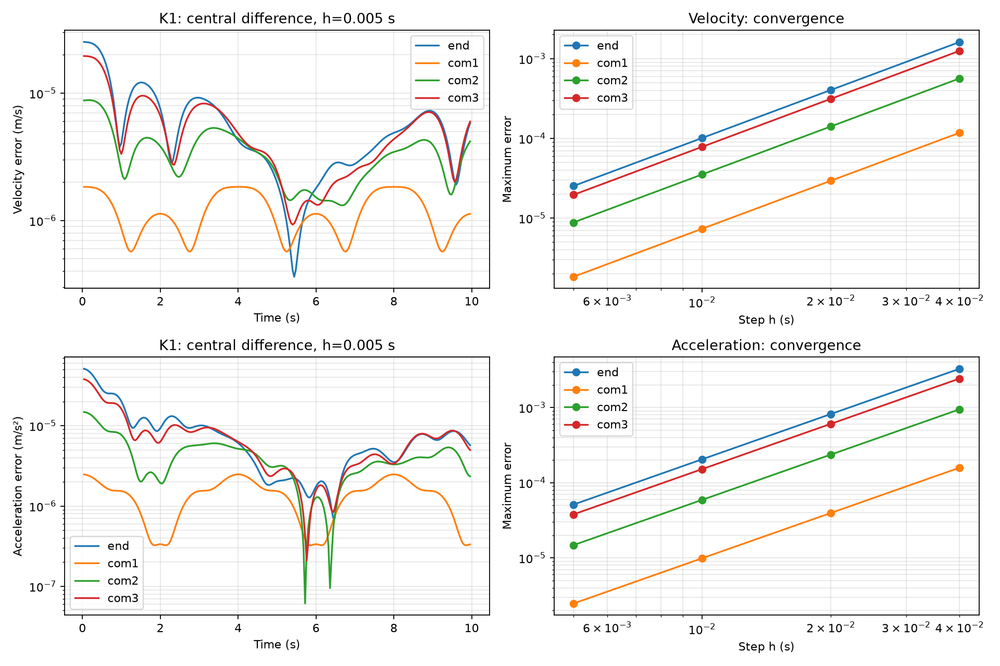
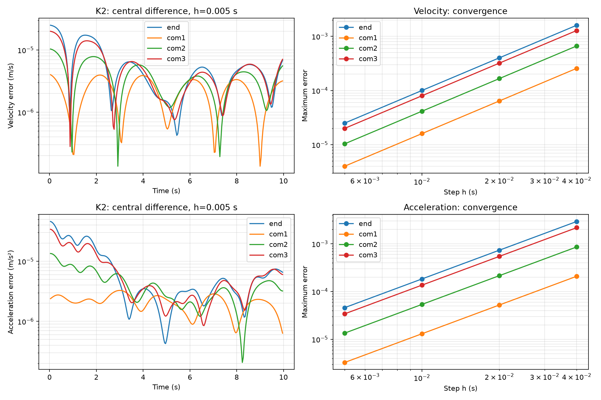

# 理论力学荣誉课程：平面三连杆机械臂分析

使用虚功原理和四个雅可比矩阵，将三根连杆质心处的重力及末端负载重力转换为关节重力补偿力矩。考虑静摩擦时，计算电机力矩绝对值最小的静态保持解。

运动学任务一、二在同一机械臂上增加移动载体，用逐级复合运动计算末端及质心状态，并以中心差分独立验证。模型选择和公式推导见本文后半部分。

## 文件结构

- `model/`：几何、雅可比、静力矩和摩擦模型。
- `visualization/`：关节角扫描和自锁可视化。
- `task1.py`：交互入口。
- `assets/`：结果图片。
- [静力学分析报告](静力学分析报告.md)：模型、方法和图片分析。

## 运行

```bash
python -m venv .venv
source .venv/bin/activate
pip install -r requirements.txt
python task1.py
```

物理参数可以通过命令行设置；省略时使用任务书基准值：

```bash
python task1.py --lengths 0.40 0.35 0.20 --masses 3.0 2.5 1.0 --load-mass 2.0 --gravity 9.81
```

函数接口同样支持 `lengths`、`masses`、`load_mass`、`gravity` 关键字参数。单位依次为 m、kg、kg、m/s²。函数接收弧度，交互输入使用度。最大静摩擦力矩 `Fc` 的单位为 N·m。

## 结果与分析

下列三幅图左侧为无摩擦力矩，右侧为各关节静摩擦上限为 2 N·m 时的最小保持力矩。扫描的是不同静止位形，不是运动过程。

### 固定关节 1、2，扫描关节 3



三个关节力矩具有相同的角度变化项和不同的常数偏移。

### 固定关节 1、3，扫描关节 2



第一、第二关节的无摩擦力矩之差保持不变。

### 固定关节 2、3，扫描关节 1



整体姿态变化使三个关节的重力补偿力矩呈周期变化。改变一个关节相对角一般会影响多个关节的力矩。

### 自锁位形与静摩擦余量



各关节静摩擦上限均为 3 N·m。自锁指电机输出为零时，静摩擦足以维持当前位形。筛选条件为各关节重力补偿力矩绝对值均不超过静摩擦上限；颜色表示三关节最小余量 `min(Fc - abs(tau_g))`，其中 `tau_g` 是未扣除摩擦的力矩。

黄色表示余量较大，紫色表示接近摩擦极限。图采用每轴 40 点的离散采样，空白处不能直接解释为连续空间中完全不存在自锁位形。

选项 5 输入 `3` 可重建该图。`assets/self-lock.png` 和 `assets/self-lock-2.0Nm.png` 是旧算法留下的历史图片，未用于当前报告。

## 运动学任务一、二

任务一实现载体、动点和合成引擎三个接口，计算末端与三个质心的绝对运动及加速度分解。任务二用绝对位置的中心差分验证解析递推结果，并检查步长收敛性。本次不包含任务三的逆向跟踪与抓取、任务四的完整后处理或进阶任务。

### 模型选择与运动规律

沿用平面三转动关节机械臂，杆长为 $L=(0.40,0.35,0.20)$ m，质心位于各杆中点。质量沿用静力学设置，但不参与运动学计算。基座固定于载体原点，基座坐标轴与载体系一致。关节角 $q_i$ 为相对前一级的角度，逆时针为正；长度、时间、角度内部统一使用 m、s、rad。

参考系为惯性系 $S_0$、载体系 $S_1$、依次固连于三根杆的 $S_2,S_3,S_4$。选择两种含转动的载体，是为了分别检查简单定轴转动和平面一般运动中的速度、加速度合成。

|载体|位置与姿态|选择理由|
|---|---|---|
|K1 匀速转台|$\mathbf O=(0,0)$，$\varphi=0.4t$|角加速度为零，便于观察向心加速度和科氏加速度|
|K2 船体垂荡＋横摇|$\mathbf O=(0,0.15\sin(2\pi t/4))$，$\varphi=(10\pi/180)\sin(2\pi t/5)$|同时包含原点平动、角速度变化和角加速度，检验一般情形|

K2 为理想化运动输入，不求解船体受力。设垂荡幅值 $H=0.15$ m、频率 $\nu=2\pi/4$，横摇幅值 $B=10\pi/180$ rad、频率 $\mu=2\pi/5$，则载体接口返回：

$$
\mathbf v_O=(0,H\nu\cos\nu t),\qquad
\mathbf a_O=(0,-H\nu^2\sin\nu t),
$$
$$
\omega=B\mu\cos\mu t,\qquad
\alpha=-B\mu^2\sin\mu t.
$$

关节采用平滑简谐规律，使解析导数已知，同时使相对运动和载体转动共存：

$$
q_i=q_{0i}+A_i\sin(\Omega_i t),\quad
\dot q_i=A_i\Omega_i\cos(\Omega_i t),\quad
\ddot q_i=-A_i\Omega_i^2\sin(\Omega_i t).
$$

其中 $q_0=(30,-20,15)^\circ$，$A=(20,15,10)^\circ$，周期 $P=(4,3,2.5)$ s，$\Omega_i=2\pi/P_i$。角度参数先转成弧度再计算。默认仿真 $0\le t\le10$ s，输出步长 0.01 s。载体参数在 `carrier_k1`、`carrier_k2` 中设置，关节参数集中在 `joint_motion` 中。

### 从旋转坐标系推导合成公式

用二维旋转矩阵和转过正 90° 的算子表示平面叉积：

$$
R(\varphi)=\begin{bmatrix}\cos\varphi&-\sin\varphi\\\sin\varphi&\cos\varphi\end{bmatrix},\qquad
J=\begin{bmatrix}0&-1\\1&0\end{bmatrix},\qquad J^2=-I.
$$

动点在局部系中的位置、相对速度、相对加速度记为 $\boldsymbol\rho,\dot{\boldsymbol\rho},\ddot{\boldsymbol\rho}$，父系中局部系原点为 $\mathbf O$。令 $\omega=\dot\varphi$、$\alpha=\ddot\varphi$，有 $\dot R=\omega JR$。父系中的点位置为：

$$
\mathbf p=\mathbf O+R\boldsymbol\rho.
$$

对该通用坐标变换求导得到运输定理：

$$
\mathbf v=\mathbf v_O+\omega JR\boldsymbol\rho+R\dot{\boldsymbol\rho}.
$$

再求一次导数，分别保留旋转和局部运动的贡献：

$$
\begin{aligned}
\mathbf a={}&\mathbf a_O+\alpha JR\boldsymbol\rho
+\omega J(\omega JR\boldsymbol\rho+R\dot{\boldsymbol\rho})
+\omega JR\dot{\boldsymbol\rho}+R\ddot{\boldsymbol\rho}\\
={}&\mathbf a_O+\alpha JR\boldsymbol\rho-\omega^2R\boldsymbol\rho
+2\omega JR\dot{\boldsymbol\rho}+R\ddot{\boldsymbol\rho}.
\end{aligned}
$$

这里两次出现 $\omega JR\dot{\boldsymbol\rho}$：一次来自牵连速度随相对位置改变，另一次来自相对速度向量随坐标轴转动。因此科氏项系数为 2。统一转到父系坐标后，令 $\mathbf r=R\boldsymbol\rho$、$\mathbf v_r=R\dot{\boldsymbol\rho}$，得到：

$$
\boxed{\mathbf a_e=\mathbf a_O+\alpha J\mathbf r-\omega^2\mathbf r},\qquad
\boxed{\mathbf a_r=R\ddot{\boldsymbol\rho}},\qquad
\boxed{\mathbf a_C=2\omega J\mathbf v_r},\qquad
\boxed{\mathbf a=\mathbf a_e+\mathbf a_r+\mathbf a_C}.
$$

牵连项包含原点平动加速度、切向加速度和向心加速度。若载体无转动，则科氏项为零；若点相对载体静止，则相对项与科氏项均为零。科氏项为零并不意味着向心项为零。

### 三连杆如何用同一个引擎递推

对第 $i$ 根杆，其坐标系相对父系的转角、角速度、角加速度为 $q_i,\dot q_i,\ddot q_i$。原点偏置为 $\mathbf d_1=(0,0)$、$\mathbf d_i=(L_{i-1},0)$（$i=2,3$）；偏置在父系中固定，所以该级原点的**相对**速度和加速度为零。

求某根杆上的点时，从该点所属连杆开始：末端局部位置为 $(L_3,0)$，第 $i$ 根杆质心局部位置为 $(L_i/2,0)$；固连点的局部速度和加速度均为零。每经过一级，令 $R_i=R(q_i)$，使用：

$$
\begin{aligned}
\mathbf p_{\rm parent}&=\mathbf d_i+R_i\mathbf p_{\rm local},\\
\mathbf v_{\rm parent}&=\dot q_iJR_i\mathbf p_{\rm local}+R_i\mathbf v_{\rm local},\\
\mathbf a_{\rm parent}&=\ddot q_iJR_i\mathbf p_{\rm local}
-\dot q_i^2R_i\mathbf p_{\rm local}
+2\dot q_iJR_i\mathbf v_{\rm local}+R_i\mathbf a_{\rm local}.
\end{aligned}
$$

将本级输出作为上一级的局部输入。例如末端依次从 $S_4\to S_3\to S_2\to S_1$，得到相对基座的完整状态；随后使用载体接口，从 $S_1\to S_0$ 得到绝对状态。中间层输出仍是相对其父系的运动，只有到达惯性系后才称为绝对运动。该递推没有调用雅可比或数值差分计算速度、加速度。

分解取决于选定的动系。最终 CSV 中的 $\mathbf a_e,\mathbf a_r,\mathbf a_C$ 以载体系 $S_1$ 为动系、用 $S_0$ 分量表示；其中 $\mathbf a_r$ 已包含机械臂内部所有逐级运动的贡献。内部每级分解另行输出，不能将各层科氏项不经变换地直接相加作为最终科氏项。

### 程序接口与数据格式

实现位于 [model/kinematics.py](model/kinematics.py)，运行入口为 [kinematics_tasks.py](kinematics_tasks.py)。

|接口|输入|输出与坐标约定|
|---|---|---|
|`carrier(t)`|时间（s）|`FrameState(origin, velocity, acceleration, angle, omega, alpha)`；原点向量用父系坐标表示|
|`arm_points(q, qd, qdd, lengths)`|三个关节角及其解析导数、杆长|末端和三个质心的 `PointState(position, velocity, acceleration)`，均相对载体系；同时返回各级递推结果|
|`compose(frame, point)`|局部参考系状态与局部动点状态|`Composition(state, ae, ar, aC)`；所有结果统一用父系坐标表示|
|`evaluate(t, carrier, lengths, motion)`|时间、载体函数、杆长、关节规律函数|相对状态、绝对合成结果、逐级结果|

新增载体只需提供相同的 `carrier(t)` 返回值，计算引擎无需修改；如需纳入批量导出，在入口的 `CARRIERS` 字典中注册即可。`motion(t)` 返回 `(q, qd, qdd)`。

`*_motion.csv` 每行对应一个时刻、一个点，包含 `time_s, point, frame`，以及 `p/v/a/ae/ar/aC` 各自的 `_x,_y` 分量。位置单位 m，速度 m/s，加速度 m/s²；`point` 为 `end, com1, com2, com3`，`frame` 为 `S0`。动力学可直接读取三个质心行的 `a_x,a_y`。

`*_stages.csv` 使用相同物理量列，`mapping` 如 `S4_to_S3` 指明本级变换，其输出坐标为箭头右侧参考系。`*_errors.csv` 保存逐时刻误差范数，`validation_summary.csv` 保存各步长的最大误差、均方根误差及归一化误差。

### 中心差分验证与通过判据

验证位置使用已有 `forward_kinematics` 独立计算，再乘载体旋转矩阵并加原点位置，不复用递推产生的位置。先核对两条路径的位置一致，再直接对独立绝对位置做中心差分：

$$
\mathbf v_h(t)=\frac{\mathbf p(t+h)-\mathbf p(t-h)}{2h},\qquad
\mathbf a_h(t)=\frac{\mathbf p(t+h)-2\mathbf p(t)+\mathbf p(t-h)}{h^2}.
$$

泰勒展开给出 $\mathbf v_h=\mathbf v+h^2\mathbf p^{(3)}/6+O(h^4)$，$\mathbf a_h=\mathbf a+h^2\mathbf p^{(4)}/12+O(h^4)$。因此在截断误差主导区间，步长减半，误差应约减至四分之一；观测阶定义为 $p_{\rm obs}=\log_2(E_h/E_{h/2})$，应接近 2。

对 K1、K2 的全部四个点验证，取 $h=0.04,0.02,0.01,0.005$ s。在间隔 0.04 s 的共同内部时刻计算误差，避免不同步长的采样点不同影响比较。端点不参与验证，输出运动数据仍包含端点。误差为二维向量差的范数，统计最大误差和均方根误差。

通过条件为：最细步长归一化最大误差小于 $10^{-3}$，最后两级步长的观测阶在 $[1.8,2.2]$。归一化分母取解析结果最大模长与 1 m/s（速度）或 1 m/s²（加速度）中较大者，避免运动量接近零时相对误差失真。独立位置核对使用 `rtol=atol=1e-12`。程序失败时返回非零退出码。

误差来源包括中心差分截断、浮点相减消减及端点处理。二阶差分除以 $h^2$ 会放大舍入误差，不能无限减小步长。角度保持连续，不先包裹到 $[-\pi,\pi]$；验证直接差分笛卡尔位置，所以跨越 ±π 不产生人为跳变。上述收敛判据针对默认平滑工况。

### 运行与结果

```bash
python kinematics_tasks.py
python -m unittest discover -s tests -v
```

可用 `--duration 10 --dt 0.01 --output assets/kinematics` 修改输出设置；`--dt` 控制任务一的数据间隔，任务二独立使用上述四个验证步长。运行会生成或覆盖输出目录中的结果和根目录的 [运动学分析报告](运动学分析报告.md)。无图形界面的环境也可运行；若 Matplotlib 默认缓存不可写，可在命令前设置 `MPLCONFIGDIR=/tmp/robotic-arm-mpl`。





图左侧展示最细步长下四个点的速度、加速度误差随时间变化，右侧展示最大误差随步长变化。具体误差和通过情况记录在报告中。额外测试覆盖全静止、固定基座、纯平移、静止机械臂随转台转动，以及有明确非零科氏项的径向滑动案例。
